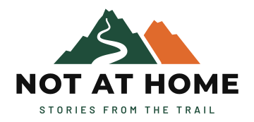

# Not at Home: brand identity

This is the final brand identity for the Not at Home forum, approved on 2026-10-14.
Open [`preview.html`](preview.html) in a browser to see every logo version, the palette and the fonts in use.

Earlier explorations live in [`rejected-proposals/`](rejected-proposals/README.md) and are **not** part of the brand.



---

## 1. Name and slogan

| | |
|---|---|
| **Name** | Not at Home |
| **Slogan** | Stories from the trail |
| **In the logo** | Both in all caps: **NOT AT HOME** / **STORIES FROM THE TRAIL** |
| **In running text** | Title case for the name ("Not at Home"), sentence case for the slogan ("Stories from the trail") |

## 2. Logo

### Concept

Two mountain peaks with uneven, rocky ridgelines. A trail winds up the front peak: it starts wide at the foot and gets thinner as it climbs, with shorter switchbacks higher up, so it reads as going into the distance. The trail ties the mark to the slogan. The wordmark sits under the mountains.

### Files

All files are in [`logo/`](logo/). Text in every SVG is converted to outlines, so no font needs to be installed to display them.

| File | Use |
|---|---|
| [`logo-full.svg`](logo/logo-full.svg) | Full logo (mark, name, slogan) on white or light backgrounds |
| [`logo-full-dark.svg`](logo/logo-full-dark.svg) | Full logo on black or dark backgrounds |
| [`logo-full-mono.svg`](logo/logo-full-mono.svg) | Full logo in one color |
| [`logo-horizontal.svg`](logo/logo-horizontal.svg) | Compact one-line logo (mark and name) for the top bar, light backgrounds |
| [`logo-horizontal-dark.svg`](logo/logo-horizontal-dark.svg) | Compact logo on dark backgrounds |
| [`logo-horizontal-mono.svg`](logo/logo-horizontal-mono.svg) | Compact logo in one color |
| [`mark.svg`](logo/mark.svg) | The mountains alone, for avatars, empty states and places where the name is already shown |
| [`favicon.svg`](logo/favicon.svg) | Simplified mark on a Pine tile, for browser tabs (16 to 32 px) |
| [`favicon-32.png`](logo/favicon-32.png) | PNG fallback favicon, 32 × 32 |
| [`icon-192.png`](logo/icon-192.png) | Web app manifest icon, 192 × 192 |
| [`apple-touch-icon.png`](logo/apple-touch-icon.png) | iOS home-screen icon, 180 × 180, square (iOS rounds the corners) |

The `-mono` files are drawn in `currentColor`. Inline them in the page and set the CSS `color` (for example white on a Pine background). Loaded through an `` tag they render black.

### Which version to use

- **Light background:** `logo-full.svg` or `logo-horizontal.svg`.
- **Dark background:** the `-dark` versions. They switch the front peak and the slogan to Pine light so they stay visible.
- **On a Pine or Ember background, a photo, or anything else that isn't plain white or black:** the `-mono` version, in white or black, whichever has more contrast.
- **Top bar:** `logo-horizontal`. The full logo is for the home page, the login and sign-up pages, emails and the README.

### Clear space and minimum size

- Keep empty space around the logo at least as large as the height of the letter **N** in the wordmark.
- Full logo: at least 160 px wide on screen.
- Horizontal logo: at least 120 px wide (about 22 px tall).
- Below that, use `mark.svg`. Below 32 px, use the favicon, which has a thicker trail that stays visible at 16 px.

### Don't

- Recolor the logo outside the palette below, or swap the two peak colors.
- Stretch, rotate, outline or add shadows or gradients to it.
- Retype the wordmark in another font or in mixed case.
- Use the full-color light version on a dark background, or the reverse.
- Place it on a busy photo without a solid or darkened area behind it.

## 3. Color palette

Two brand colors plus black and white, per section 2.2 of the requirements.

### Brand colors

| Name | Hex | RGB | Role |
|---|---|---|---|
| **Pine** | `#1F4D3A` | 31, 77, 58 | Primary. Front peak, primary buttons, links, focus rings, the favicon tile. |
| **Ember** | `#E06A2C` | 224, 106, 44 | Accent. Back peak, calls to action that need to stand out, highlights, active and selected states. |
| Black | `#111111` | 17, 17, 17 | Text, wordmark on light backgrounds |
| White | `#FFFFFF` | 255, 255, 255 | Backgrounds, text on Pine, wordmark on dark backgrounds |

### Supporting tints

These are lighter or darker versions of the two brand colors, not extra brand colors. Use them only where the brand color doesn't work.

| Name | Hex | Use |
|---|---|---|
| **Pine light** | `#7FB89A` | Pine for dark mode: front peak in the dark logo, links, primary buttons (with black text) |
| **Ember text** | `#C2531D` | Ember for small text on white (links or labels that must be orange). Ember itself is too light for body text on white. |
| Dark background | `#121212` | Reference dark-mode page background used for the contrast checks below |

### Contrast (WCAG 2.1)

AA needs 4.5:1 for normal text and 3:1 for large text (24 px, or 19 px bold) and UI shapes.

| Text / foreground | Background | Ratio | Result |
|---|---|---|---|
| White | Pine | 9.63:1 | AAA. Primary buttons, top bar on Pine. |
| Black | Ember | 5.64:1 | AA. Ember buttons always use black text. |
| White | Ember | 3.35:1 | Large text and icons only. Don't use for button labels. |
| Ember | White | 3.35:1 | Large text, icons and borders only |
| Ember text `#C2531D` | White | 4.62:1 | AA |
| Black | White | 18.88:1 | AAA |
| Pine light | Dark `#121212` | 8.23:1 | AAA |
| Black | Pine light | 8.30:1 | AAA. Primary buttons in dark mode. |
| Ember | Dark `#121212` | 5.59:1 | AA |
| White | Dark `#121212` | 18.73:1 | AAA |
| Pine light | White | 2.28:1 | Don't use. Pine light is for dark mode only. |

## 4. Typography

All fonts are free on [Google Fonts](https://fonts.google.com) (SIL Open Font License).

| Role | Font | Weights | Notes |
|---|---|---|---|
| Wordmark | **Montserrat** ExtraBold | 800 | All caps, letter spacing +0.04 em. Already outlined in the logo files. Don't retype the logo. |
| Slogan | **Barlow** SemiBold | 600 | All caps, letter spacing +0.30 em. Already outlined in the logo files. |
| UI headings (recommended) | **Montserrat** | 700, 800 | Same family as the wordmark |
| UI body text (recommended) | **Barlow** | 400, 500, 600 | Same family as the slogan, readable at small sizes |
| Code blocks in posts | System monospace stack | 400 | `ui-monospace, SFMono-Regular, Menlo, Consolas, monospace` |

The logo fonts are final. The UI fonts are the recommended default for the Bootstrap theme, picked from the same two families so the interface matches the logo.

```html
<link rel="preconnect" href="https://fonts.googleapis.com">
<link rel="preconnect" href="https://fonts.gstatic.com" crossorigin>
<link href="https://fonts.googleapis.com/css2?family=Barlow:wght@400;500;600&family=Montserrat:wght@700;800&display=swap" rel="stylesheet">
```

## 5. Design tokens for Bootstrap

This is a starting point for the Bootstrap 5.3 theme (section 4 of the requirements: "themed with the brand tokens, light and dark modes"). Set the Sass variables before importing Bootstrap.

```scss
// Brand
$pine:        #1F4D3A;
$pine-light:  #7FB89A;
$ember:       #E06A2C;
$ember-text:  #C2531D;
$ink:         #111111;

// Bootstrap theme colors
$primary:     $pine;
$warning:     $ember;   // or a custom "accent" theme color for CTAs and highlights
$dark:        $ink;
$body-color:  $ink;
$link-color:  $pine;

// Fonts
$font-family-sans-serif: "Barlow", system-ui, -apple-system, "Segoe UI", Roboto, sans-serif;
$headings-font-family:   "Montserrat", "Barlow", system-ui, sans-serif;
$headings-font-weight:   700;
$font-family-monospace:  ui-monospace, SFMono-Regular, Menlo, Consolas, monospace;
```

```css
/* Dark mode overrides (Bootstrap color modes) */
[data-bs-theme="dark"] {
  --bs-body-bg: #121212;
  --bs-body-color: #FFFFFF;
  --bs-primary: #7FB89A;
  --bs-primary-rgb: 127, 184, 154;
  --bs-link-color: #7FB89A;
  --bs-link-color-rgb: 127, 184, 154;
  --bs-link-hover-color: #A3CDB6;
}
```

In dark mode, primary buttons use Pine light with black text (`--bs-btn-color: #111111`). Swap the logo to the `-dark` files there.
