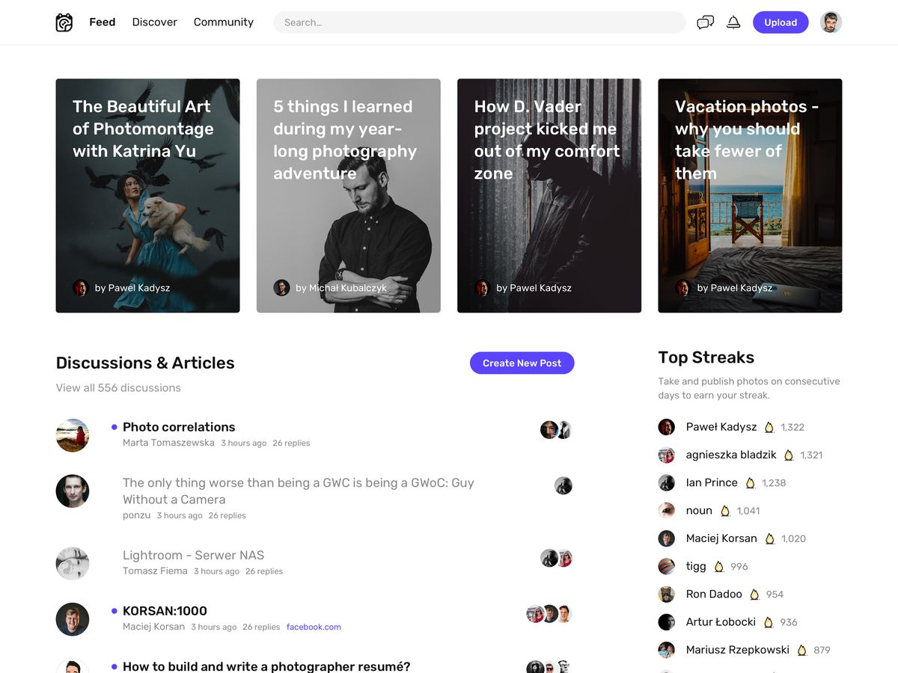

## Design inspiration

### Home

For the home I was thinking on something like this, in terms of elements and distribution, but the first block should be the categories and its image as background instead of posts.

Then, the following block is fine, topics and users.

Content of the top bar can be adjusted to our needs, the distribution is what I like, logo + nav links on the left, search at center, "new post" button + user menu on the right.
